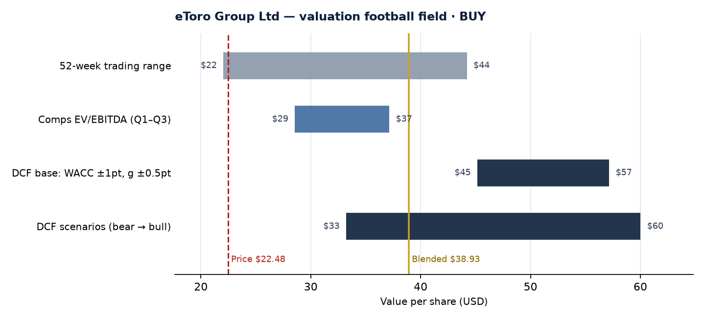

# equity-research-toolkit

[](https://github.com/Lucas-Medina-Dev/equity-research-toolkit/actions/workflows/ci.yml)


**A valuation engine for listed fintechs: two-case DCF, trading comps with outlier control, scenario weighting, reverse DCF, and an Excel model with live formulas. One YAML file in, a full valuation out.**

It implements the [research framework](docs/research-framework.md) I wrote for a student equity research division covering fintechs. The worked example values **eToro (NASDAQ: ETOR)** on its public filings, with every input sourced.

<p align="center"></p>

---

## The eToro example in one table

| | Value per share |
|---|---:|
| DCF — base (50%) | $50.25 |
| DCF — bear (25%) | $33.22 |
| DCF — bull (25%) | $60.01 |
| **DCF, probability-weighted** | **$48.43** |
| Comps, EV/EBITDA median 4.9x (Plus500, IG, IBKR) | $29.43 |
| **Blended (50% DCF / 50% comps)** | **$38.93** |
| Share price (6 Nov 2026) | $22.48 |

WACC 12.3% (Blume-adjusted beta 1.72). Terminal value is 64% of EV, and the implied exit multiple is 8.5x EBITDA. Robinhood (29.4x) is excluded from the comps as a statistical outlier. P/E is not used because only one peer has a reliable figure.

### What the model says vs what the market prices

On these inputs the framework rates eToro **BUY**. A large gap between the model and the market is a question, not an answer, so the toolkit runs a **reverse DCF**: the share price implies a **31.6% discount rate** on the base case. No reasonable cost of equity is that high. The market is therefore pricing *lower cash flows*, not more risk per dollar. The obvious candidates:

- **Cyclicality.** Net contribution fell to $557m in 2023, then rose to $788m in 2024. Retail trading revenue is volatile, and the bear case only partly captures a repeat.
- **Crypto mix.** Crypto net contribution fell to $11m in Q2-26. Earnings quality depends on which asset class retail investors favour.
- **Capital allocation.** The $231m TradeZero acquisition is deducted in the equity bridge, but integration risk is not modelled.

A credible BUY has to argue why these risks are overpriced. The model is a tool to frame that debate, not a substitute for it.

---

## What it does

| Step | Module | Detail |
|---|---|---|
| Choose the method | `cases.py` | Case 1 (pre-profit) or Case 2 (profitable), from the streak of positive EBITDA / FCF ending in the latest year |
| Cost of capital | `wacc.py` | CAPM, Blume beta adjustment for short trading histories, Hamada un/relevering, WACC |
| DCF | `dcf.py` | FCFF build (NOPAT + D&A − capex − ΔNWC on incremental revenue), mid-year convention, Gordon terminal value, terminal share of EV, implied exit multiple |
| Case 1 margins | `cases.py` | Linear margin convergence to a profitable-peer target, reached *before* the terminal year |
| Equity bridge | `bridge.py` | Haircut on cash held against regulatory capital, leases, committed outflows (e.g. signed M&A) |
| Comps | `comps.py` | Tukey fences (1.5×IQR) to drop outliers, minimum-peer rule, median point estimate, Q1–Q3 range |
| Scenarios | `valuation.py` | Bear / base / bull with probability weights, framework blend (60/40 or 50/50), Buy/Hold/Sell bands |
| Reverse DCF | `valuation.py` | Bisection on the discount rate that equates the base case to the price |
| Sensitivity | `sensitivity.py` | WACC × terminal growth, and EBIT-margin × revenue-growth shifts of the whole path |
| KPIs | `kpis.py` | Rule of 40, EBITDA and net margin, revenue per funded account, revenue yield on AUA |
| Outputs | `excel.py`, `charts.py`, `report.py` | Excel model, football field, Markdown summary, JSON |

### The Excel model is live, not a dump

The DCF sheet is built from **formulas that point to named input cells** (`wacc`, `tg`, `tax`, `cash`...). Change the WACC or a margin in the workbook and the valuation updates. Inputs are blue and formulas black, following the banking convention. The test suite recalculates the workbook with LibreOffice and checks that it matches the Python engine (relative tolerance 1e-9).

→ [`examples/output/etor_valuation.xlsx`](examples/output/etor_valuation.xlsx). Sheets: Summary, Inputs, DCF, Scenarios, Sensitivity, Comps, Sources.

---

## Quick start

```bash
git clone https://github.com/Lucas-Medina-Dev/equity-research-toolkit.git
cd equity-research-toolkit
pip install -e .
erkit value examples/etoro.yaml --out output/
```

Outputs: `etor_valuation.xlsx`, `etor_football_field.png`, `etor_summary.md` and `etor_valuation.json`.

To value another company, copy [`examples/etoro.yaml`](examples/etoro.yaml) (Case 2) or [`examples/template_high_growth.yaml`](examples/template_high_growth.yaml) (Case 1, illustrative numbers) and replace the inputs. Each number sits next to its source:

```yaml
cost_of_capital:
  risk_free: 0.0494             # [S7] US 10Y Treasury, 30 Oct 2026
  equity_risk_premium: 0.0428   # [S8] Damodaran implied ERP, 1 Aug 2026
  raw_beta: 2.08                # [S9] ~18 months of trading since the May-2025 IPO
  blume_adjust: true            # short history → shrink towards 1

forecast:
  scenarios:
    base:
      weight: 0.50
      revenue_growth: [0.09, 0.08, 0.07, 0.06, 0.05]
      ebit_margin:    [0.310, 0.315, 0.320, 0.325, 0.330]
```

As a library:

```python
from erkit.config import load_config
from erkit.valuation import value_company, implied_discount_rate

cfg = load_config("examples/etoro.yaml")
r = value_company(cfg)
r.case, r.wacc, r.blended_per_share, r.rating   # Case.PROFITABLE, 0.1232, 38.93, 'BUY'
implied_discount_rate(cfg)                      # 0.316
```

---

## Modelling choices worth defending

- **Net contribution, not gross revenue.** eToro books crypto sales at gross value (~$12bn of revenue). Margins on that base mean nothing, so net contribution is the top line.
- **GAAP EBIT in the DCF, adjusted EBITDA in the comps.** The DCF uses GAAP operating income, so share-based compensation is treated as a real cost. Peer EV/EBITDA multiples from data vendors are on adjusted figures, so eToro's adjusted EBITDA is used against them. The mismatch is documented rather than hidden.
- **Haircut on cash.** A multi-licence broker cannot distribute all its cash. 25% is held back as regulatory capital, which is an assumption, and it is shown as one.
- **No EV/Revenue for brokers.** Peers report revenue on different bases (gross vs net of costs), so the multiple is switched off in the config rather than averaged blindly.
- **Outliers are excluded and reported.** A 29x peer next to three 5–8x peers would double the mean (5.9x → 11.8x). Tukey fences remove it, and the summary says so.
- **Conservative terminal discounting.** Cash flows use the mid-year convention, but the terminal value is discounted at the end of year N.

## Tests

```bash
pip install -e ".[dev]"
pytest          # 31 tests
ruff check src tests
```

The tests cover hand-calculated DCF values, beta adjustments, case selection edge cases (a streak broken by one loss-making year), outlier exclusion, quartiles that match Excel's `QUARTILE.INC`, a reverse DCF that recovers the price, Excel/Python parity after recalculation, and the CLI. CI runs them on Python 3.10–3.12.

## Repository layout

```
src/erkit/        valuation engine (cases, wacc, dcf, bridge, comps, valuation, sensitivity, kpis)
                  + outputs (excel, charts, report) and CLI
examples/         etoro.yaml (sourced), template_high_growth.yaml (Case 1), output/
docs/             research-framework.md, football_field.png
tests/            unit + end-to-end tests
```

## Limitations

- Peer multiples are a dated snapshot from public aggregators, which disagree with each other. Refresh them before relying on the comps.
- The model uses one discount rate across scenarios, so risk is expressed through the scenarios rather than through the WACC.
- This is an educational project, not investment advice.

---

MIT © 2026 Lucas Medina
